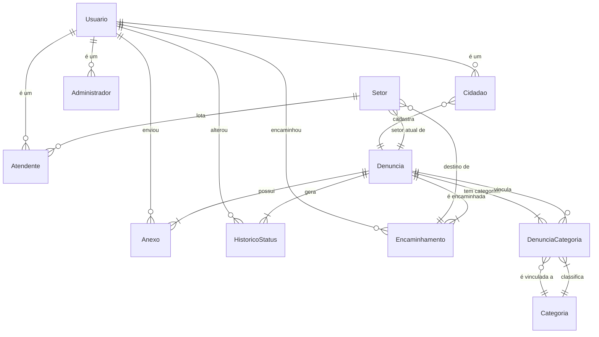

# Modelo de Dados — Sistema Para Denunciar Problemas Urbanos

> **Banco:** SQLite via TypeORM (`synchronize: false`, migrações na próxima atividade).  
> **Histórias Must atendidas (Canvas §4):**  
> 1. Cadastrar denúncia (título, descrição, categoria, localização)  
> 2. Anexar foto do problema  
> 3. Visualizar e gerenciar denúncias recebidas  
> 4. Encaminhar denúncia para o setor responsável e atualizar o status  
> 5. Acompanhar o status da denúncia  

---

## 1. Diagnóstico (antes × depois)

### Antes (estado atual do código)
| Entidade | Observação |
|----------|------------|
| `Usuario` | Base com herança (`TableInheritance`) para `Cidadao`, `Atendente`, `Administrador`. |
| `Cidadao` | Subtipo de `Usuario` (cpf, bairro). |
| `Atendente` | Subtipo de `Usuario` (matrícula, lotação em `Setor`). |
| `Administrador` | Subtipo de `Usuario` (nível de acesso). |
| `Denuncia` | `categoria` era um `enum` em texto (`CategoriaDenuncia`) — valor que se repete e não pode ser gerenciado dinamicamente. |
| `Setor` | Nome, e-mail, ativo. |
| `Anexo` | Vinculado a uma `Denuncia` (CASCADE) e a um `Usuario` (SET NULL). |
| `HistoricoStatus` | Linha do tempo de mudanças de status. |
| `Encaminhamento` | Vincula `Denuncia` → `Setor` (destino) com observação. |

**Problemas encontrados:**
1. **Campo que deveria ser entidade:** `Denuncia.categoria` era um `enum` fixo em texto. Não há como adicionar/editar categorias sem mudar código, e não há relação formal entre denúncias e categorias.
2. **Sem relação N-N:** todo o modelo era 1-N ou N-1. A regra de negócio "uma denúncia pode ter mais de uma categoria" não era representável.
3. **Faltavam índices compostos** para as consultas frequentes de listagem (filtro por categoria + status, e por setor + status).
4. **Faltava `unique` no e-mail** de `Usuario`.

### Depois (modelo atualizado)
Foram adicionadas 2 entidades e ajustadas 2 existentes:

| Entidade | O que mudou | Por quê |
|----------|-------------|---------|
| `Categoria` | **NOVA** — `id`, `nome` (único), `descricao`, `ativo`, datas. | Substitui o `enum` em texto; permite gerenciar categorias sem mudar código. |
| `DenunciaCategoria` | **NOVA** — entidade associativa N-N entre `Denuncia` e `Categoria` com dados próprios (`dataVinculacao`, `ehPrincipal`). | Implementa a N-N exigida pelo M04 etapa 13. |
| `Denuncia` | `categoria` passou de `CategoriaDenuncia` (enum) para `string` (valor da categoria). Adicionados `@OneToMany` para `DenunciaCategoria` e dois `@Index` compostos. | Normaliza o domínio e melhora consultas de listagem. |
| `Usuario` | `email` passou a ter `unique: true`. | Duas pessoas não podem ter o mesmo e-mail de cadastro. |

Total de entidades: **11** (acima do mínimo de 5 exigido).
---

## 2. Diagrama ER (Mermaid)



Legenda dos símbolos (conforme cheatsheet M04):
- `||` = exatamente um (obrigatório)
- `o{` = zero ou muitos (opcional)
- `|{` = um ou muitos (obrigatório)


---

## 3. Tabela de Chaves Estrangeiras (relação · onDelete · justificativa de negócio)

| Relação (Filho → Pai) | onDelete | Justificativa de negócio |
|-----------------------|----------|--------------------------|
| `Denuncia.cidadao` → `Usuario` | `RESTRICT` | Um cidadão com denúncias cadastradas não pode ser excluído enquanto houver denúncias vinculadas; caso contrário, perderíamos o registro de quem registrou o problema. |
| `Denuncia.setorAtual` → `Setor` | `SET NULL` | Se um setor for desativado/excluído, as denúncias atuais dele continuam existindo (precisam ser reatribuídas, não apagadas). |
| `Anexo.denuncia` → `Denuncia` | `CASCADE` | Um anexo não existe sem a denúncia a que pertence (foto/documento sem contexto perde todo o valor). |
| `Anexo.enviadoPor` → `Usuario` | `SET NULL` | O anexo continua valendo como prova mesmo que o usuário que enviou seja removido do sistema. |
| `HistoricoStatus.denuncia` → `Denuncia` | `RESTRICT` | O histórico de status é prova da tramitação; não pode ficar órfão se a denúncia for excluída. |
| `HistoricoStatus.alteradoPor` → `Usuario` | `SET NULL` | O registro da mudança de status continua valendo mesmo que o servidor que alterou seja desligado. |
| `Encaminhamento.denuncia` → `Denuncia` | `RESTRICT` | Não se pode excluir uma denúncia que já possui encaminhamentos registrados (perderíamos o rastro). |
| `Encaminhamento.setorDestino` → `Setor` | `RESTRICT` | Não se pode excluir um setor que já foi destino de encaminhamentos. |
| `Encaminhamento.enviadoPor` → `Usuario` | `RESTRICT` | Não se pode excluir o servidor que realizou um encaminhamento enquanto esse registro existir. |
| `DenunciaCategoria.denuncia` → `Denuncia` | `CASCADE` | Se a denúncia for excluída, a associação com categoria não faz sentido sem ela. |
| `DenunciaCategoria.categoria` → `Categoria` | `RESTRICT` | Não se pode excluir uma categoria que já está vinculada a denúncias (perderíamos a classificação). |
| `Atendente.setor` → `Setor` | `SET NULL` | O atendente continua existindo mesmo que seu setor seja desativado; ele será realocado. |


---

## 4. Colunas e Restrições

### 4.1 Decisões por coluna (seleção das principais)

| Tabela | Coluna | Tipo | nullable | Justificativa |
|--------|--------|------|----------|---------------|
| `denuncias` | `id` | `uuid` | NOT NULL | ID exposto em URL; `uuid` evita enumeração sequencial. |
| `denuncias` | `titulo` | `varchar(100)` | NOT NULL | Campo obrigatório para identificar o problema. |
| `denuncias` | `descricao` | `varchar(1000)` | NOT NULL | Obrigatório para que a prefeitura compreenda o problema. |
| `denuncias` | `categoria` | `varchar(20)` | NOT NULL | Nome da categoria vinculada (texto normalizado). |
| `denuncias` | `latitude` | `real` | NOT NULL | Coordenada obrigatória; `CHECK` entre -90 e 90. |
| `denuncias` | `longitude` | `real` | NOT NULL | Coordenada obrigatória; `CHECK` entre -180 e 180. |
| `denuncias` | `status` | `varchar(20)` | NOT NULL, default `'recebida'` | Enum de situação: `recebida`, `encaminhada`, `em_andamento`, `resolvida`. |
| `denuncias` | `cidadaoId` | `varchar` | NULL | Denúncia pode ser anônima (sem cidadão logado). |
| `denuncias` | `setorAtualId` | `varchar` | NULL | Ainda não encaminhada a um setor. |
| `usuarios` | `email` | `varchar(160)` | NOT NULL, **UNIQUE** | Login/contato; não pode haver duplicatas. |
| `usuarios` | `telefone` | `varchar(20)` | NULL | Contato opcional do cidadão. |
| `anexos` | `url` | `varchar(500)` | NOT NULL | Endereço do arquivo anexado. |
| `anexos` | `tipo` | `varchar(20)` | NOT NULL | `imagem` ou `documento` (CHECK). |
| `historico_status` | `statusAnterior` | `varchar(20)` | NULL | Nulo na criação da denúncia (sem status anterior). |
| `historico_status` | `statusAtual` | `varchar(20)` | NOT NULL | Sempre há um status atual. |
| `historico_status` | `alteradoPorId` | `varchar` | NULL | `null` = alteração feita pelo sistema. |
| `encaminhamentos` | `observacao` | `varchar(500)` | NULL | Complemento opcional ao encaminhar. |
| `encaminhamentos` | `aceite` | `datetime` | NULL | Preenchido somente quando o setor destino aceita. |
| `categorias` | `nome` | `varchar(100)` | NOT NULL, **UNIQUE** | Nome da categoria (ex: "buraco", "poste"). |
| `denuncias_categorias` | `ehPrincipal` | `boolean` | NOT NULL, default `false` | Indica a categoria principal para exibição. |


### 4.2 Restrições no banco (2+ exigidas)

| # | Restrição | Tabela | Coluna(s) | Regra que protege |
|---|-----------|--------|-----------|-------------------|
| 1 | `UNIQUE` | `usuarios` | `email` | Duas pessoas não podem se cadastrar com o mesmo e-mail. |
| 2 | `UNIQUE` | `setores` | `nome` | Não existem dois setores com o mesmo nome (evita duplicidade na gestão). |
| 3 | `UNIQUE` composto | `denuncias_categorias` | `denunciaId`, `categoriaId` | Uma mesma categoria não pode ser vinculada duas vezes à mesma denúncia. |
| 4 | `UNIQUE` composto | `encaminhamentos` | `denunciaId`, `setorDestinoId` | Não se cria dois encaminhamentos pendentes para a mesma denúncia para o mesmo setor. |
| 5 | `CHECK` | `denuncias` | `latitude` | Valor entre -90 e 90 (coordenada válida). |
| 6 | `CHECK` | `denuncias` | `longitude` | Valor entre -180 e 180 (coordenada válida). |
| 7 | `CHECK` | `historico_status` | `statusAnterior`, `statusAtual` | Mudança real de status: `statusAnterior IS NULL OR statusAnterior <> statusAtual`. |
| 8 | `CHECK` | `historico_status` | `statusAtual` | Valor entre `recebida`, `encaminhada`, `em_andamento`, `resolvida`. |
| 9 | `CHECK` | `anexos` | `tipo` | Valor entre `imagem` e `documento`. |
| 10 | `CHECK` | `usuarios` | `matricula`, `tipo` | Matrícula só é preenchida quando `tipo = 'atendente'`. |
| 11 | `CHECK` | `usuarios` | `setorId`, `tipo` | `setorId` só é preenchido quando `tipo = 'atendente'`. |
| 12 | `CHECK` | `usuarios` | `nivelAcesso`, `tipo` | `nivelAcesso` só existe quando `tipo = 'administrador'` (valores 1 ou 2). |

### 4.3 Índices compostos (além das PKs/FKs já indexadas)

| Índice | Tabela | Coluna(s) | Motivo |
|--------|--------|-----------|--------|
| `IDX_denuncias_categoria_status` | `denuncias` | `categoria`, `status` | Listagem filtrada por categoria e status (tela de gerenciamento da prefeitura). |
| `IDX_denuncias_setorAtualId_status` | `denuncias` | `setorAtualId`, `status` | Denúncias de um setor, filtradas por status (tela do atendente). |
| `IDX_historico_status_denunciaId` | `historico_status` | `denunciaId` | Linha do tempo de uma denúncia (acompanhamento do cidadão). |
| `IDX_anexos_denunciaId` | `anexos` | `denunciaId` | Listar anexos de uma denúncia. |


---

## 5. Resumo das relações exigidas pelo M04

| Tipo | Exemplo no modelo | Implementação |
|------|-------------------|---------------|
| 1-N | `Denuncia` → `Anexo` | `@OneToMany` + `@ManyToOne` com `onDelete: 'CASCADE'` |
| 1-N | `Denuncia` → `HistoricoStatus` | `@OneToMany` + `@ManyToOne` com `onDelete: 'RESTRICT'` |
| 1-N | `Setor` → `Denuncia` (`setorAtual`) | `@OneToMany` + `@ManyToOne` com `onDelete: 'SET NULL'` |
| N-N (com dados próprios) | `Denuncia` ⇄ `Categoria` | Entidade associativa `DenunciaCategoria` com duas 1-N (`dataVinculacao`, `ehPrincipal`) |

---

## 6. Observações técnicas

- **Banco:** SQLite não possui `timestamptz` nativo; usamos `datetime` para instantes, que é o mapeamento do TypeORM para SQLite.
- **IDs:** todas as entidades usam `uuid` (`@PrimaryGeneratedColumn('uuid')`), adequado para exposição em URLs.
- **`synchronize: false`**: intencional — o banco será gerenciado por migrações (próxima atividade, M05), não por `synchronize`, evitando perda de dados.
- **Herança:** `Usuario` usa `TableInheritance` com coluna discriminadora `tipo` (`cidadao`, `atendente`, `administrador`).

---

## 7. Seção de Verificação (M05/M06)

### 7.1 Banco nasce das migrações

Banco vazio (`dev.db` removido) → `npm run migration:run` aplicou todas as migrações sem erro:

```
8 migrations are already loaded in the database.
1 migrations are new migrations must be executed.
Migration CriarCategoriasEDenunciasCategorias1793961819160 has been executed successfully.
```

Tabelas criadas: `denuncias`, `usuarios`, `setores`, `encaminhamentos`, `historico_status`, `anexos`, `categorias`, `denuncias_categorias`.

`npm run migration:revert` desfez a última migração (dropou `categorias` e `denuncias_categorias`) sem erro, e `npm run migration:run` as recriou.

### 7.2 Listagem com relações (sem N+1)

Com `LOG_QUERIES=true`, a listagem `GET /api/denuncias` dispara **2 consultas**:

1. `SELECT DISTINCT ...` (contagem total com LEFT JOIN nas relações)
2. `SELECT ... FROM "denuncias" ... LEFT JOIN "denuncias_categorias" ... LEFT JOIN "categorias" ... LEFT JOIN "setores"` (dados paginados)

As relações `setorAtual` e `categorias.categoria` são carregadas via `LEFT JOIN` em uma única consulta — **não há N+1**.

Exemplo de resposta (2 itens, com N-N exercitado):

```json
{
  "pagina": 1,
  "limite": 20,
  "total": 2,
  "itens": [
    {
      "id": "66666666-6666-6666-6666-666666666006",
      "titulo": "Buraco na Rua das Flores",
      "categoria": "buraco",
      "status": "recebida",
      "setorAtual": null,
      "categorias": [
        { "id": "aaaaaaaa-...", "nome": "buraco", "ehPrincipal": true },
        { "id": "cccccccc-...", "nome": "lixo", "ehPrincipal": false }
      ]
    }
  ]
}
```

### 7.3 Restrições funcionando

**UNIQUE `usuarios.email`:**

```bash
curl -X POST http://localhost:3001/api/cidadaos \
  -H 'Content-Type: application/json' \
  -d '{"nome":"Maria Duplicate","email":"maria@email.com","cpf":"111.222.333-44","bairro":"Centro"}'
```

Resposta:

```json
{
  "statusCode": 409,
  "mensagem": "Já existe um usuário com o e-mail maria@email.com."
}
```

Status HTTP: **409** (não 500).

**RESTRICT (exclusão bloqueada):**

```sql
PRAGMA foreign_keys = ON;
DELETE FROM usuarios WHERE id = '33333333-3333-3333-3333-333333333003';
-- cidadão com denúncias vinculadas
```

Resultado do banco: `FOREIGN KEY constraint failed` (exclusão rejeitada).

